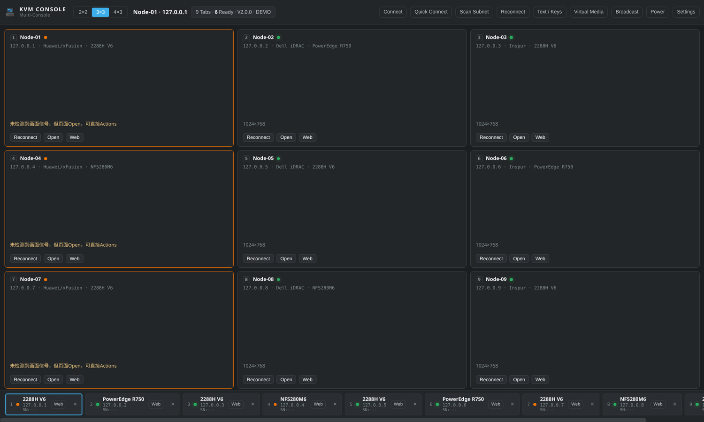

# KVM Console

**多路网页 KVM 控制台 · Multi-session BMC KVM console**

把华为/超聚变 iBMC、戴尔 iDRAC、浪潮 ISBMC 的网页 KVM 收进一个窗口：网格/聚焦切换、快速连接、网段扫描、文本与按键广播、虚拟媒体、电源控制和统一的快捷键。



---

## 为什么做这个

现场技术人员经常要同时面对几台、十几台刚下架或待上架的服务器：

- 每台机器开一个浏览器标签，登录页、KVM 弹窗、会话超时混在一起；
- 设备没有正式命名，做台账比修机器还麻烦；
- BMC 默认凭据、KVM 入口、虚拟介质入口各厂商都不一样。

KVM Console 用**连接历史 + 网段扫描**代替设备台账，不强制命名；打开应用就是上次的会话，关掉标签即释放 BMC 会话。

## 功能

| 能力 | 说明 |
|---|---|
| 多路常驻 | 每个标签一个 BMC 会话，切换只改变可见性，不重新加载 |
| 网格 / 聚焦 | 单设备自动聚焦；网格支持方向键选择，选中窗格有蓝色外环 |
| 自动登录 | 按厂商识别登录页，自动填默认/历史凭据；失败转手动，不反复锁号 |
| 网段扫描 | ARP + TCP 443/80 + Redfish 身份 + 默认凭据验证，结果逐台出现 |
| 快速连接 | 搜索历史与已打开会话；↑/↓ 选择、Enter 打开、Delete 删除 |
| 文本/按键 | 文本、预设（点击直接发送）、常用组合键，支持多目标 |
| CLI 终端 | 对勾选的多台 BMC 批量执行 `racadm` / `ipmitool` 命令，逐台输出结果 |
| 广播 | 将普通按键和 Shift 组合同步到勾选的目标，带目标选择 |
| 虚拟媒体 | 戴尔走 Redfish；华为/超聚变走 iBMC 网页本地上传 |
| 电源 | 开机/软关机/强制关机/软重启/强制重启/NMI，全部二次确认 |
| 重连/重置 | 按目标重连；重置会清除本机凭据、Cookie、VNC/许可缓存 |
| 下载 | 统一保存到 `下载/KVM-Console`；顶栏下载按钮常驻，圆形进度，点击打开下载管理 |
| 主题/语言 | 自动跟随系统明暗；中文/English 自动按系统语言选择 |

## 支持的设备

| 厂商 | 方式 |
|---|---|
| 华为 iBMC / 超聚变 iBMC | HTML5 KVM；JNLP 下载会被阻止 |
| 戴尔 iDRAC 7.x+ | 网页 KVM（viewer WebSocket 桥接 noVNC） |
| 戴尔 iDRAC 3.x/4.x | 旧 viewer 依赖独立弹窗，内嵌可能失败；可手动选择 VNC |
| 浪潮 ISBMC | 网页 KVM（按固件差异可能需要手动填 KVM 地址） |
| 通用 BMC | 通用登录 + KVM 入口识别 |

戴尔虚拟控制台/虚拟介质通常需要 **Enterprise 许可证**。华为/超聚变新固件首次登录可能强制改密，程序会把页面交给你手动处理。

## 安装

### Arch Linux

```bash
sudo pacman -U kvm-console-2.0.11-1-x86_64.pkg.tar.zst
kvm-console
```

包使用系统 Electron，安装体积很小。

### Windows

到 Releases 下载 `KVM-Console-*-win-x64-setup.exe`，或使用 portable 免安装版。

> Windows 包当前未签名，首次运行可能触发 SmartScreen。

### 从源码运行

```bash
npm install
npm start
```

演示模式（内置 9 台 mock BMC，不需要真实设备）：

```bash
npm run demo
```

## 默认快捷键

所有快捷键都可以在「设置 → 功能」里改绑。

| 动作 | 默认 |
|---|---|
| 连接 | `Ctrl+Shift+N` |
| 快速连接 | `Ctrl+Shift+T` |
| 扫描网段 | `Ctrl+Shift+S` |
| 重连 | `Ctrl+Shift+R` |
| 文本/快捷键 | `Ctrl+Shift+I` |
| CLI 终端 | `Ctrl+Shift+X` |
| 虚拟媒体 | `Ctrl+Shift+V` |
| 广播 | `Ctrl+Shift+B` |
| 电源 | `Ctrl+Shift+P` |
| 设置 | `Ctrl+Shift+Alt+S` |
| 上一个 / 下一个标签 | `Ctrl+Shift+←` / `Ctrl+Shift+→` |
| 关闭标签 | `Ctrl+Shift+W` |
| 聚焦 / 窗格切换 | `Ctrl+Shift+Space` |
| 退出 | `Ctrl+Q` |

快捷键只在应用前台生效，不会注册为系统全局热键。

## 使用说明

完整的安装、连接、扫描、媒体、电源和排障说明见：

- [使用文档](docs/USAGE.md)
- [HTML 版](docs/USAGE.html)

## CLI 终端

顶栏「终端」打开后，会沿用当前勾选的目标，选择 `racadm` 或 `ipmitool` 输入命令；命令逐台执行，输出按主机分段显示。

Windows 安装包已内置 `resources/tools/win/racadm.exe` 和 `ipmitool.exe`；Linux 开发环境使用系统 `racadm` / `ipmitool`。

## Windows 安装器

安装器使用 Inno Setup，可选择是否创建桌面/开始菜单快捷方式。构建见 [Windows 安装器](docs/WINDOWS-INSTALLER.md)。

## Windows 签名

开源项目可申请 SignPath 免费签名；也支持 PFX 和 Azure Trusted Signing。步骤见 [Windows 签名](docs/WINDOWS-SIGNING.md)。

## 数据与安全

- 连接历史：Linux `~/.config/kvm-console/`，Windows `%APPDATA%\kvm-console\`；
- 密码默认使用系统钥匙串加密；钥匙串不可用时降级保存并明确告警；
- 连接 BMC 会接受自签证书，这是为兼容厂商默认配置；
- 本工具面向**受控管理网络**，不要暴露到公网；
- 扫描会尝试每台最多 2 组默认凭据，可能触发账号锁定策略，使用前确认网络环境。

安全问题请按 [SECURITY.md](SECURITY.md) 私下报告，不要在公开 Issue 中贴出地址、账号、Cookie 或 SN。

## 开发

```bash
npm install
npm run build     # TypeScript
npm start         # 正常启动
npm run demo      # 9 台 mock BMC
npm test          # node:test：布局、Range、Redfish、扫描
npm run smoke     # 无头快速验证
```

项目结构：

```
src/main/          Electron 主进程、会话、扫描、Redfish、媒体、存储
src/preload/       contextBridge API 与 KVM 页面快捷键捕获
src/renderer/      原生 HTML/CSS/JS UI、noVNC
test/              node:test 单元测试
packaging/arch/    Arch PKGBUILD
docs/              使用文档与设计笔记
```

构建安装包：

```bash
# Arch
cd packaging/arch && makepkg -f

# Windows
npx electron-builder --win nsis portable
```

## 已知限制

- 厂商网页会随固件更新变化，登录/KVM 入口属于启发式识别；异常时可在连接页手填 KVM 地址；
- 戴尔 iDRAC 3.x 的旧 viewer 依赖独立弹窗，内嵌 Web KVM 可能失败；
- 同一 BMC 的 KVM 会话数有限，多人同时打开会互相踢下线；
- 虚拟媒体要求 BMC 能访问本机管理网 IP，注意防火墙；
- 当前不包含固件批量升级、SOL 串口终端和 SFTP 文件传输；
- Windows 包未签名。

## 参与贡献

见 [CONTRIBUTING.md](CONTRIBUTING.md)。提交前至少运行 `npm test` 和 `npm run demo`。

## 许可证

本项目使用 [MIT License](LICENSE)。

第三方组件：

- noVNC — MPL-2.0
- Electron — MIT
- ws — MIT

详见 [THIRD_PARTY_NOTICES.md](THIRD_PARTY_NOTICES.md)。

## 致谢

- [noVNC](https://github.com/novnc/noVNC) 提供 RFB 渲染与输入；
- [Electron](https://github.com/electron/electron) 提供桌面运行时；
- 以及所有在真实机器上帮忙验证的同事。
